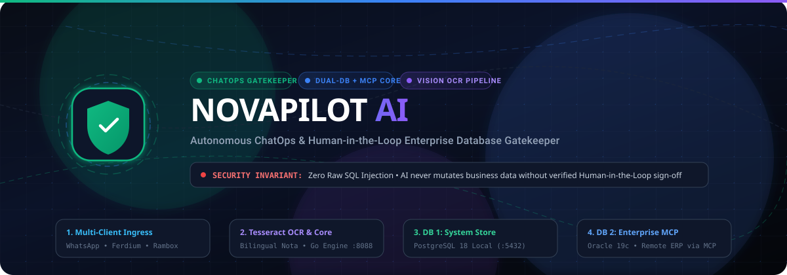

<p align="center">
  
</p>

<p align="center">
  <a href="https://github.com/RifkyA911/novapilot-ai"></a>
  <a href="./LICENSE"></a>
  <a href="https://golang.org"></a>
  <a href="https://bun.sh"></a>
  <a href="https://svelte.dev"></a>
  <a href="https://www.postgresql.org"></a>
  <a href="https://modelcontextprotocol.io"></a>
</p>

---

## 📌 Executive Summary

**NovaPilot AI** is an enterprise-grade **Human-in-the-Loop IT Operations Copilot** engineered to automate off-hours operational requests (such as invoice amendments, customer master data updates, and branch ticket escalations) originating from chat channels (Regional Branch WhatsApp Groups, Telegram, Discord, and Slack).

The platform bridges unstructured branch conversations with internal business systems under an absolute invariant:  
**Zero Raw SQL Exposure • AI never executes mutative database queries (UPDATE/DELETE) without verified human authorization.**

---

## 🏛️ Dual-Database & MCP Separation Architecture

To guarantee total transaction safety, **NovaPilot AI enforces a strict physical separation between operational system state and enterprise transactional data**:

```
+---------------------------------------------------------------------------------------------------+
|                                      UNTRUSTED / INGRESS ZONE                                     |
|  [WhatsApp / Baileys]      [Ferdium / Rambox]      [Web CRM Userscripts]     [Slack / Discord]    |
+-------------------------------------------------+-------------------------------------------------+
                                                  | Ingress Webhooks & Base64 Attachments
                                                  v
+---------------------------------------------------------------------------------------------------+
|                        NOVAPILOT CORE ENGINE (:8088 Go) & TESSERACT OCR                           |
+-------------------------------------------------+-------------------------------------------------+
                                                  |
                     +----------------------------+----------------------------+
                     | Direct Read/Write                                       | Human Approval Gate
                     v                                                         v
+------------------------------------------+             +------------------------------------------+
|       DATABASE 1: SYSTEM STORE           |             |        HUMAN-IN-THE-LOOP COCKPIT         |
|        (PostgreSQL 18 :5432)             |             |        (SvelteKit 5 + Tailwind)          |
|  - Omnichannel Inbound Messages          |             |  - Side-by-side OCR image preview        |
|  - Ticket State & Lifecycle              |             |  - Parameter Diff Inspector              |
|  - Immutable Audit Event Logs            |             |  - 1-Click Approve / Modify / Reject     |
|  - Self-Learned Correction Patterns      |             +---------------------+--------------------+
+------------------------------------------+                                   |
                                                                               | Approved Execution
                                                                               v
                                                         +------------------------------------------+
                                                         |     ENTERPRISE MCP CONNECTOR SERVER      |
                                                         |  - Model Context Protocol (JSON-RPC)     |
                                                         |  - Strict Schema Validation              |
                                                         |  - Zero Raw SQL Execution Guarantee      |
                                                         +---------------------+--------------------+
                                                                               |
                                                                               | Managed Tool Mutation
                                                                               v
                                                         +------------------------------------------+
                                                         |      DATABASE 2: ENTERPRISE DATA         |
                                                         |     (Oracle 19c / SAP / Remote ERP)      |
                                                         |  - Official Invoices & Payments          |
                                                         |  - General Ledger & Customer Master      |
                                                         +------------------------------------------+
```

| Component | Database 1: System Operational Store | Database 2: Enterprise Business Data Source |
| :--- | :--- | :--- |
| **Engine / Host** | **PostgreSQL 18 Local** (`:5432`, `novapilot_db`) | **Oracle 19c / SAP HANA / Remote ERP / MySQL** |
| **Ownership** | NovaPilot AI Core Application | Corporate Core ERP / IT Infrastructure |
| **Access Channel** | Direct SQL via Go `pgxpool` driver pool | **Strictly Model Context Protocol (MCP) Tool Server** |
| **Data Scope** | Inbound raw payloads, tickets, audit trails, learned regex weights | General Ledger, Invoices, Customer Records, Bank Settlements |
| **ChatOps Access** | Staged automatically on webhook receipt | **ZERO direct access**. No credentials or raw ports exposed. |
| **Execution Policy** | Automated state transitions & audit trail | Requires Human-in-the-Loop signature via Web Cockpit |

> 📖 **Read Full Specification:** [**`docs/ARCHITECTURE_DUAL_DB_MCP.md`**](./docs/ARCHITECTURE_DUAL_DB_MCP.md)

---

## 🌟 Key Features & Capabilities

- **1-Click On-Call Sign-Off:** Replaces late-night VPN logins and manual DBeaver SQL typing with a single tap on desktop or phone via the Web Cockpit.
- **Tesseract Vision OCR Pipeline:** Automatically unwraps ephemeral/view-once WhatsApp image buffers and extracts physical invoices/faktur (`INV/2026/001`) with bilingual (`ind` + `eng`) dictionaries.
- **Interactive Client Hook Ecosystem:** High-resolution animated SVG visualizer with **Pan & Zoom controls** (drag, wheel zoom, reset), realistic status indicators, and accurate flowing paths only for connected adapters.
- **Real-Time Omnichannel Inbound Feed:** Live message feed across WhatsApp, Telegram, Discord, and Slack with Server-Sent Events (SSE) and 2.5s auto-polling fallback.
- **Self-Adapting Learning Loop:** Corrections made by engineers in the UI persist into `learned_patterns` in DB 1, adapting regex heuristics in real-time.
- **WA Gateway Exec Terminal:** Real-time interactive terminal popup communicating directly with WhatsApp Baileys daemon on port 3002 with live stdout log streaming and CLI commands (`ping`, `status`, `test_log`, `clear`).
- **Streaming System Logs:** Interactive daemon terminal log viewer with level filtering (INFO, WARN, ERROR, DEBUG), auto-scroll, and JSON export.
- **Whitelisted Group Directory:** Directory of branch WhatsApp groups, Telegram alert channels, and authorized admins with 1-click test simulation.

---

## 🧭 Cockpit Module Overview

| Route | Module Name | Description |
| :--- | :--- | :--- |
| [`/dashboard`](http://localhost:3000/dashboard) | **Dashboard Overview** | Operations KPIs, 7-day traffic trend chart, and platform ingress distribution. |
| [`/dashboard/cockpit`](http://localhost:3000/dashboard/cockpit) | **Cockpit Overview** | Deep AI analytics: Intent classification distribution, OCR accuracy, and token metrics `[PREVIEW]`. |
| [`/dashboard/queue`](http://localhost:3000/dashboard/queue) | **Approval Queue** | Pending ChatOps mutation tickets, side-by-side semantic diff inspector, and 1-click approval. |
| [`/dashboard/history`](http://localhost:3000/dashboard/history) | **Execution History** | Immutable audit log trail with compensating rollback scripts. |
| [`/dashboard/connectors`](http://localhost:3000/dashboard/connectors) | **Dual-DB Connectors** | Real Go database pool telemetry, genuine diagnostic ping roundtrip, and schema catalog. |
| [`/dashboard/mcp`](http://localhost:3000/dashboard/mcp) | **MCP Knowledge Base** | Model Context Protocol JSON-RPC specification, Dual-DB separation, and interactive tool tester. |
| [`/dashboard/connectivity`](http://localhost:3000/dashboard/connectivity) | **System Telemetry** | LAN IP probes, Go runtime memory metrics, and Ferdium/Rambox health probes. |
| [`/dashboard/logs`](http://localhost:3000/dashboard/logs) | **System Logs** | Real-time streaming daemon terminal logs from Core :8088, DB 1 :5432, and WA Gateway. |
| [`/dashboard/messages`](http://localhost:3000/dashboard/messages) | **Inbound Messages** | Real-time omnichannel feed with OCR attachment preview, 1-click ticket staging, and Exec Terminal. |
| [`/dashboard/hooks`](http://localhost:3000/dashboard/hooks) | **Client Hook Flows** | Interactive Pan & Zoom SVG pipeline for WhatsApp, Ferdium, Rambox, and Baileys. |
| [`/dashboard/contacts`](http://localhost:3000/dashboard/contacts) | **Group Contacts** | Directory of whitelisted regional branch WhatsApp groups and authorized admins `[PREVIEW]`. |
| [`/dashboard/simulator`](http://localhost:3000/dashboard/simulator) | **ChatOps Simulator** | Step-by-step interactive simulator: Ingest, Parse, Validate, and Stage tickets `[EXPERIMENTAL]`. |
| [`/dashboard/platforms`](http://localhost:3000/dashboard/platforms) | **Platform Flows** | ChatOps credentials, webhook endpoints, and channel whitelist configuration. |
| [`/dashboard/settings`](http://localhost:3000/dashboard/settings) | **System Settings** | Gatekeeper policies, high-value transaction approval thresholds, and Dual-DB connection pools. |
| [`/dashboard/about`](http://localhost:3000/dashboard/about) | **About & Creator** | Creator profile (Rifky / @RifkyA911), architectural manifesto, and official GitHub repository links. |

---

## 🛠️ Technology Stack

- **Backend Core:** Go (Golang) 1.22+
  - Clean Architecture (`domain`, `repository`, `service`, `handler`)
  - Gin REST Engine + High-performance SSE EventBus
  - PostgreSQL 18 Local pgxpool driver + Oracle ERP MCP connector
- **Frontend WebUI:** SvelteKit 5 + Bun Runtime + Tailwind CSS + shadcn-svelte
  - Pan & Zoom vector graphics engine
  - Real-time reactivity via Svelte 5 Runes (`$state`, `$derived`, `$effect`)
  - Better Auth session gatekeeper
- **WhatsApp Gateway:** TypeScript + Bun using `@whiskeysockets/baileys`
  - Ephemeral/view-once media unwrapping
  - Local Tesseract OCR vision engine
- **Model Context Protocol (MCP):** `@modelcontextprotocol/sdk` tool server

---

## 🚀 Quickstart Guide

### 1. Clone & Setup Repository
```bash
git clone https://github.com/RifkyA911/novapilot-ai.git
cd novapilot-ai
```

### 2. Initialize Database 1 (PostgreSQL 18 Local)
```bash
psql -U postgres -h 127.0.0.1 -p 5432 -c "CREATE DATABASE novapilot_db;"
psql -U postgres -h 127.0.0.1 -p 5432 -d novapilot_db -f backend/scripts/mock_db/01_schema.sql
psql -U postgres -h 127.0.0.1 -p 5432 -d novapilot_db -f backend/scripts/mock_db/02_test_data.sql
psql -U postgres -h 127.0.0.1 -p 5432 -d novapilot_db -f backend/scripts/mock_db/03_learned_patterns.sql
```

### 3. Start NovaPilot AI Core Backend (:8088)
```bash
cd backend
go build -o bin/server.exe ./cmd/server
./bin/server.exe
# Core API running at http://127.0.0.1:8088
```

### 4. Start SvelteKit 5 Cockpit (:3000)
```bash
cd frontend
bun install
bun run dev
# Cockpit running at http://localhost:3000
```

### 5. Start WhatsApp Baileys Gateway (:3002)
```bash
cd whatsapp-gateway
bun install
bun run src/index.ts
# Scan QR code via WhatsApp Mobile: Linked Devices
```

---

## 📁 Repository Documentation

- [**`docs/ARCHITECTURE_DUAL_DB_MCP.md`**](./docs/ARCHITECTURE_DUAL_DB_MCP.md) — Dual-Database & MCP Architecture Specification.
- [**`docs/PRD.md`**](./docs/PRD.md) — Product Requirements Document.
- [**`docs/SECURITY_AND_COMPLIANCE.md`**](./docs/SECURITY_AND_COMPLIANCE.md) — WhatsApp ToS Compliance & Security Guardrails.
- [**`docs/WHATSAPP_GATEWAY_TUTORIAL.md`**](./docs/WHATSAPP_GATEWAY_TUTORIAL.md) — Step-by-Step WhatsApp Baileys Gateway Tutorial.
- [**`docs/UNIVERSAL_HOOKS_GUIDE.md`**](./docs/UNIVERSAL_HOOKS_GUIDE.md) — Ferdium, Rambox, and Browser Tampermonkey Injection Guide.
- [**`CONTRIBUTING.md`**](./CONTRIBUTING.md) — Contribution Guidelines and Pull Request Checklist.
- [**`CODE_OF_CONDUCT.md`**](./CODE_OF_CONDUCT.md) — Contributor Covenant v2.1.
- [**`LICENSE`**](./LICENSE) — MIT License.
