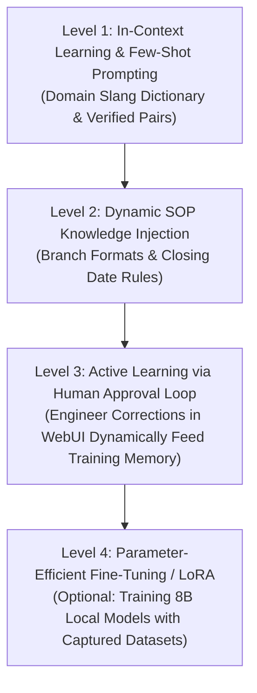

# 🧠 AI Specification, Configuration & Agent Training Mechanism

---

## 1. Supported AI Platforms, Models & Technology Stack

NovaPilot AI employs the **AI Provider Adapter Pattern** in Golang. The platform remains vendor-agnostic, enabling effortless model switching via `.env` configurations:

| Platform / Provider | Recommended Models | Characteristics & Use Cases |
| :--- | :--- | :--- |
| **Google Gemini API** *(Default)* | `gemini-1.5-flash`, `gemini-2.0-flash` | Ultra-fast latency (<800ms), massive context window, native JSON Structured Outputs, and exceptional multilingual understanding of informal regional dialects. |
| **OpenAI / Azure OpenAI** | `gpt-4o-mini`, `gpt-4o` | Enterprise-grade strict JSON Schema compliance and guaranteed SLAs. |
| **Anthropic Claude** | `claude-3-5-sonnet`, `claude-3-5-haiku` | Premier choice for nuanced reasoning over multi-clause corporate SOP policies. |
| **Local / On-Premise (Ollama / vLLM)** | `qwen2.5-coder:7b/14b`, `deepseek-r1:8b`, `llama3.3:8b` | **100% Air-Gapped & Offline**. Zero chat data leaves the factory intranet. Recommended when corporate security forbids outbound cloud calls. |
| **Antigravity CLI (`agy -p`)** | Gemini 3.8 / Pro via local pipe | Direct integration with Antigravity developer environment for local agent debugging. |

---

## 2. Configuration Parameters & Hyperparameters

Deterministic extraction is paramount; creative hallucinations are strictly intolerable. Model hyperparameters are constrained accordingly:

```env
# AI Engine Configuration
AI_PROVIDER=gemini                     # Options: gemini | openai | anthropic | ollama
AI_MODEL_NAME=gemini-1.5-flash
AI_TEMPERATURE=0.0                     # Strictly 0.0 - 0.1 for deterministic entity parsing
AI_TOP_P=0.95
AI_MAX_OUTPUT_TOKENS=1024
AI_REQUEST_TIMEOUT_MS=5000            # 5-second timeout to prevent queue stalling
AI_FALLBACK_PROVIDER=ollama            # Automatic fallback to local models on network drop
```

### Enforced JSON Output Contract
The AI engine is constrained to return strictly valid JSON matching this schema:

```json
{
  "type": "object",
  "properties": {
    "intent": {
      "type": "string",
      "enum": ["UPDATE_CUSTOMER_NAME", "CHECK_INVOICE_STATUS", "CANCEL_INVOICE", "GENERAL_QUERY", "IGNORED"]
    },
    "document_type": { "type": "string", "enum": ["NOTA", "SURAT_JALAN", "FAKTUR_PAJAK", "UNKNOWN"] },
    "document_number": { "type": "string", "description": "Extracted invoice or document number" },
    "field_target": { "type": "string", "description": "Target field to amend (e.g. customer_name)" },
    "new_value": { "type": "string", "description": "Corrected customer or company name" },
    "branch_origin": { "type": "string", "description": "Branch origin hub if detected" },
    "reason": { "type": "string", "description": "Reason stated in the message" },
    "confidence_score": { "type": "number", "minimum": 0, "maximum": 1 }
  },
  "required": ["intent", "document_number", "new_value", "confidence_score"]
}
```

---

## 3. Agent Training & Adaptation Mechanism

> [!NOTE]
> **Foundation Understanding:** Pre-training large foundation models from scratch is unnecessary and cost-prohibitive. NovaPilot AI educates its agent through **4 Intelligent Adaptation Levels**:



---

### Level 1: In-Context Learning & Few-Shot Prompting
System prompts include 15–20 curated examples of noisy branch chat paired with desired JSON schemas:
- *"please change cv maju invoice 089"* $\rightarrow$ Intent: `UPDATE_CUSTOMER_NAME`, Target: `"CV MAJU"`, Doc: `"089"`

### Level 2: Dynamic SOP Knowledge Injection
Before processing messages, the backend injects current corporate business constraints:
- Branch numbering syntax rules (e.g., Surabaya: `SBY/INV/...`, Medan: `MDN/INV/...`).
- Accounting period cutoff dates (automatic flagging of closed month revisions).

### Level 3: Active Learning via Human Approval Loop (The Core Innovation!)
The platform improves continuously through human operator interactions:

```
[Incoming Chat] ──> [AI Predicts JSON] ──> [Presented in WebUI to John Doe]
                                                      │
                               ┌──────────────────────┴──────────────────────┐
                               ▼                                             ▼
                      [Engineer Approves]                           [Engineer Corrects]
                      (Prediction Accurate)                         (e.g. Fixed typos in extracted name)
                               │                                             │
                               ▼                                             ▼
                      [Committed to Audit]                          [Saved as Ground Truth Pair]
                                                                    to: `data/training/ground_truth.jsonl`
                                                                                     │
                                                                                     ▼
                                                                    [Backend Dynamically Injects This Pair
                                                                     as a New Few-Shot Prompt in Next Session!]
```

Every correction made by the on-call engineer in the WebUI is saved and instantly fed back as a few-shot example. The agent never repeats the same mistake twice.

### Level 4: Local Model Fine-Tuning (Future Milestone)
Once `ground_truth.jsonl` amasses 500+ verified enterprise cases, the dataset is exported for Parameter-Efficient Fine-Tuning (PEFT/LoRA) on local 8B models (e.g. Qwen2.5 or Llama-3.3) for 99% accuracy in fully air-gapped environments.

---

## 4. Context7 MCP Tooling During Development
The project utilizes the `context7` MCP server (`resolve-library-id` and `query-docs`) to pull authoritative, up-to-date documentation for Go database drivers, SvelteKit 5 runes, Bun runtime APIs, and Better Auth integrations.
