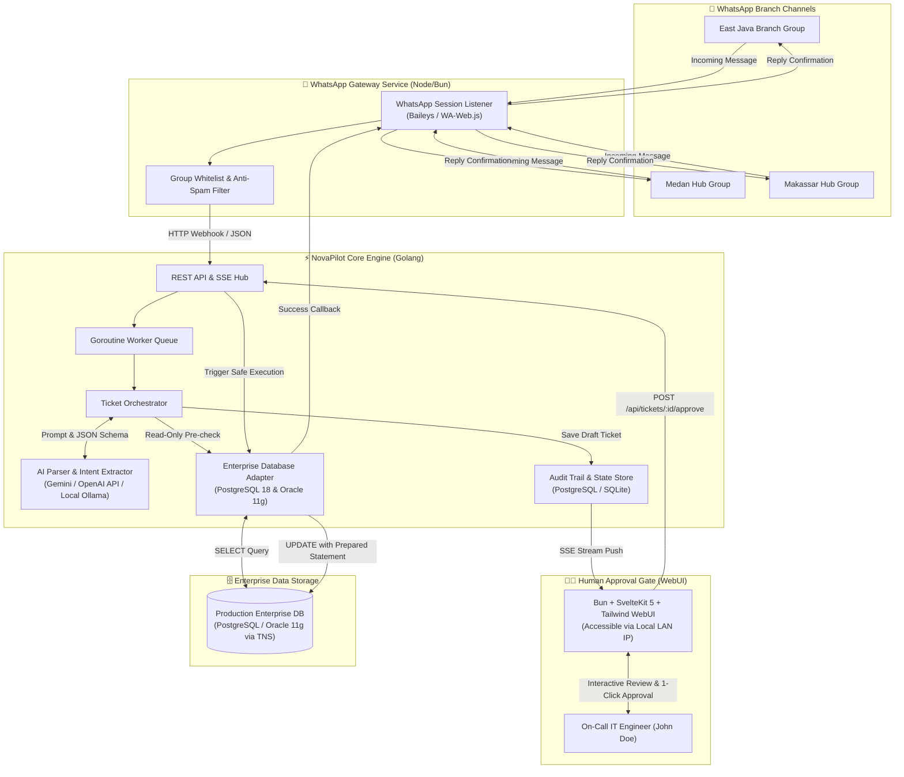
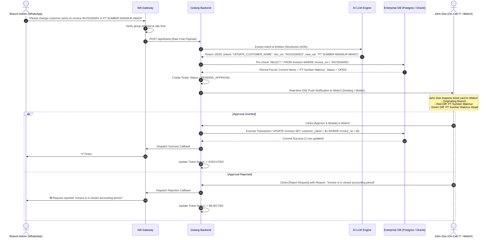

# 🏛️ System Architecture & Technical Design — NovaPilot AI

---

## 1. High-Level Architecture Overview

NovaPilot AI adopts a **Decoupled Micro-Component Architecture** separating chat ingestion, AI orchestration, human sign-off gates, and transactional database executors.



---

## 2. Sequence Diagram (Ticket Lifecycle & Approval Flow)



---

## 3. Component Details & Clean Architecture

### 3.1 Backend: Golang Clean Architecture
The backend is structured strictly following Domain-Driven Clean Architecture:

```
backend/
├── cmd/
│   ├── server/main.go           # Server entrypoint & dependency injection
│   └── seed/main.go             # Automated PostgreSQL database seeder
├── internal/
│   ├── domain/                  # Pure enterprise domain entities & interfaces
│   │   ├── ticket.go            # Ticket lifecycle model & status enums
│   │   ├── invoice.go           # Invoice entity & repository contract
│   │   ├── document.go          # Document upload attachments contract
│   │   └── audit.go             # Audit logging model
│   ├── service/                 # Core business logic & orchestration
│   │   └── ticket_service.go    # State machine validation & execution flow
│   ├── repository/
│   │   └── postgres/            # PostgreSQL adapter (prototyping & production)
│   │       ├── connector.go     # Connection pooling setup
│   │       └── repository.go    # Safe parameterized SQL operations
│   └── handler/                 # HTTP transport & event streaming
│       ├── api_handler.go       # REST endpoints & file upload multipart handler
│       └── sse_hub.go           # Real-time SSE event broadcaster
└── scripts/mock_db/             # Schema definition & seed scripts
```

### 3.2 Enterprise Database Strategy (PostgreSQL & Oracle 11g)
- **Local Prototyping:** Powered by PostgreSQL 18 with connection pooling and automated migration scripts.
- **Factory Production:** Easily swapped to Oracle 11g via the repository interface. Utilizes `TNS_ADMIN` resolution, Oracle Instant Client, and strictly parameterized SQL (`:1, :2` or `$1, $2`).
- **Zero Raw Dynamic SQL Rule:** Dynamic string concatenation for mutation queries is strictly prohibited to guarantee 100% protection against SQL injection and hallucinations.

### 3.3 SvelteKit 5 + Bun Approval Dashboard
- **Reactive Engine:** Svelte 5 runes (`$state`, `$derived`, `$props`) provide instant reactivity with zero Virtual DOM overhead.
- **Ultra-Low Memory Footprint:** Consumes only ~30MB of RAM, making it ideal for on-call engineers operating on resource-constrained laptops with VPN and database tools active.
- **Responsive LAN Accessibility:** Binds to `0.0.0.0:3000`, allowing engineers to review tickets and commit mutations directly from their mobile smartphones connected to factory Wi-Fi.

---

## 4. Operational State Machine

```
[ INCOMING_MSG ]
       │
       ▼
[ PARSING_AI ] ──(Extraction Failure / Irrelevant)──> [ IGNORED / DROPPED ]
       │
       ▼
[ VERIFYING_DB ] ──(Invoice Not Found / Closed Period)──> [ INVALID_DOCUMENT ]
       │
       ▼
[ PENDING_APPROVAL ] ──(Rejected by Engineer)──> [ REJECTED ]
       │
  (Approval Signed Off)
       ▼
[ EXECUTING_DB ] ──(DB Timeout / Conflict)──> [ EXECUTION_FAILED ]
       │
  (Commit Success)
       ▼
[ EXECUTED ] ──> [ WA_CONFIRMATION_DISPATCHED ]
```
