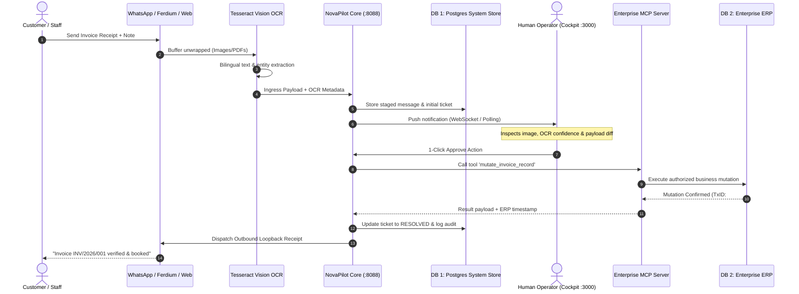

# NovaPilot AI: Dual-Database & MCP Enterprise Architecture

> **Document Version:** 2.0.0  
> **Target Audience:** Enterprise Architects, Security Compliance Teams, Full-Stack Engineers  
> **Status:** Production-Ready Blueprint  

---

## 1. Executive Summary & Core Architectural Principle

Enterprise ChatOps systems bridge untrusted communication channels (WhatsApp, Telegram, Slack, Web clients) with mission-critical internal business engines (ERP, Core Banking, Invoicing, Billing). Connecting messaging ingress hooks directly to enterprise transactional databases creates catastrophic security liabilities: SQL injection, uncontrolled privilege escalation, and unverified automated mutations.

To enforce military-grade security and transaction safety, **NovaPilot AI enforces a strict Dual-Database Separation Model**:

```
+---------------------------------------------------------------------------------------------------+
|                                      UNTRUSTED / INGRESS ZONE                                     |
|  [WhatsApp / Baileys]      [Ferdium / Rambox]      [Web CRM Userscripts]     [Slack / Discord]    |
+-------------------------------------------------+-------------------------------------------------+
                                                  | Ingress Webhooks & Base64 Attachments
                                                  v
+---------------------------------------------------------------------------------------------------+
|                        NOVAPILOT CORE ENGINE (:8088 Go) & TESSERACT OCR                           |
+-------------------------------------------------+-------------------------------------------------+
                                                  |
                     +----------------------------+----------------------------+
                     | Direct Read/Write                                       | Human Approval Gate
                     v                                                         v
+------------------------------------------+             +------------------------------------------+
|       DATABASE 1: SYSTEM STORE           |             |        HUMAN-IN-THE-LOOP COCKPIT         |
|        (PostgreSQL 18 :5432)             |             |        (SvelteKit 5 + Tailwind)          |
|  - Omnichannel Inbound Messages          |             |  - Side-by-side OCR image preview        |
|  - Ticket State & Lifecycle              |             |  - Parameter Diff Inspector              |
|  - Immutable Audit Event Logs            |             |  - 1-Click Approve / Modify / Reject     |
|  - Self-Learned Correction Patterns      |             +---------------------+--------------------+
+------------------------------------------+                                   |
                                                                               | Approved Execution
                                                                               v
                                                         +------------------------------------------+
                                                         |     ENTERPRISE MCP CONNECTOR SERVER      |
                                                         |  - Model Context Protocol (JSON-RPC)     |
                                                         |  - Strict Schema Validation              |
                                                         |  - Zero Raw SQL Execution Guarantee      |
                                                         +---------------------+--------------------+
                                                                               |
                                                                               | Managed Tool Mutation
                                                                               v
                                                         +------------------------------------------+
                                                         |      DATABASE 2: ENTERPRISE DATA         |
                                                         |     (Oracle 19c / SAP / Remote ERP)      |
                                                         |  - Official Invoices & Payments          |
                                                         |  - General Ledger & Customer Master      |
                                                         +------------------------------------------+
```

---

## 2. Deep Dive: Database 1 vs Database 2

| Attribute | Database 1: System Operational Store | Database 2: Enterprise Business Data Source |
| :--- | :--- | :--- |
| **Engine / Tech** | **PostgreSQL 18** (Local instance `:5432`) | **Oracle 19c / SAP HANA / Remote Postgres / SQL Server** |
| **Ownership** | NovaPilot AI Core Application | Corporate Core ERP / IT Infrastructure |
| **Access Channel** | Direct SQL via Go pgx driver pool | **Strictly MCP (Model Context Protocol) Tool Server** |
| **Data Scope** | Inbound raw payloads, tickets, audit trails, learned regex & classification weights | General Ledger, Invoices, Customer Records, Inventory, Bank Settlements |
| **ChatOps Access** | Staged automatically on receipt | **ZERO direct access**. No raw connection strings exposed to ChatOps. |
| **Write Policy** | Automated ingestion & state transitions | Requires Human-in-the-Loop signature or validated MCP tool call |
| **Resilience** | High write throughput, fast indexing, JSONB | ACID strictness, enterprise replicas, compliance audit |

### Database 1 Schema Overview (`novapilot_db`)
Located at [`backend/scripts/mock_db/01_schema.sql`](file:///D:/Works/Workspaces/novapilot-ai/backend/scripts/mock_db/01_schema.sql):
- `inbound_messages`: Captures raw and processed chat messages across WhatsApp, Ferdium, and Web hooks. Stores media attachment paths and OCR vision extracts.
- `tickets`: Tracks ticket lifecycle (`AWAITING_HOOK`, `PROCESSING`, `AWAITING_APPROVAL`, `RESOLVED`, `FAILED`).
- `audit_logs`: Immutable ledger of every action, tool execution, and human decision.
- `learned_patterns`: Machine-learned patterns and feedback loops for self-adapting regex, keyword classifications, and OCR corrections.

### Database 2 MCP Tool Contract Example
Rather than providing `INSERT INTO invoices ...` rights to the AI agent, mutations are mediated via MCP Tool schemas:
```json
{
  "tool": "mutate_invoice_record",
  "arguments": {
    "invoice_number": "INV/2026/001",
    "customer_id": "CUST-98214",
    "amount_due": 14500000.00,
    "currency": "IDR",
    "payment_proof_hash": "e3b0c44298fc1c149afbf4c8996fb92427ae41e4649b934ca495991b7852b855",
    "authorized_by": "supervisor_ops_01"
  }
}
```

---

## 3. The 6-Stage Hook Ecosystem Process Pipeline

The interactive visualizer in [`frontend/src/lib/components/HookEcosystemVisualizer.svelte`](file:///D:/Works/Workspaces/novapilot-ai/frontend/src/lib/components/HookEcosystemVisualizer.svelte) renders this end-to-end flow:



### Stage Breakdown:
1. **Phase 1: Multi-Client Ingress**  
   Ingests events from browser extensions (Ferdium, Rambox), web userscripts, and WhatsApp multi-device gateway sockets (Baileys).
2. **Phase 2: Ingress Hook & Vision OCR Pipeline**  
   Detects attached media (receipts, transfer slips, PDFs). Unwraps ephemeral/view-once buffers and executes local Tesseract OCR processing without leaking image bytes to 3rd-party cloud endpoints.
3. **Phase 3: NovaPilot Core & System Staging (DB 1)**  
   Core Golang engine runs intent matching, attaches context, evaluates self-learned patterns, and records full message telemetry into PostgreSQL 18.
4. **Phase 4: Human-in-the-Loop Cockpit**  
   Web dashboard displays side-by-side OCR image previews and parameter diff inspections with confidence scoring. Requires human verification before high-value actions are taken.
5. **Phase 5: Enterprise MCP Data Connector & Mutation (DB 2)**  
   Dispatches JSON-RPC tool calls to remote enterprise endpoints. Isolates target ERP / Oracle database behind strict validation schemas.
6. **Phase 6: Outbound Loopback Confirmation**  
   Generates a cryptographically verifiable transaction audit reference and dispatches confirmation directly back into the customer's WhatsApp chat or ticket thread.

---

## 4. Verification & Operational Safety Guarantees

1. **Zero Raw SQL Exposure:**  
   The ChatOps layer holds zero credentials, connection pools, or direct network ingress to DB 2.
2. **Deterministic Fallback:**  
   If the MCP tool server is unreachable or reports validation errors, the operational state in DB 1 transitions to `FAILED_AUDIT` with an alert dispatched to operators. DB 2 remains completely untouched.
3. **Traceability:**  
   Every entry in DB 2 has a corresponding audit ID in DB 1 (`audit_logs.target_reference`), guaranteeing bidirectional auditability for SOC2 and ISO27001 compliance.
