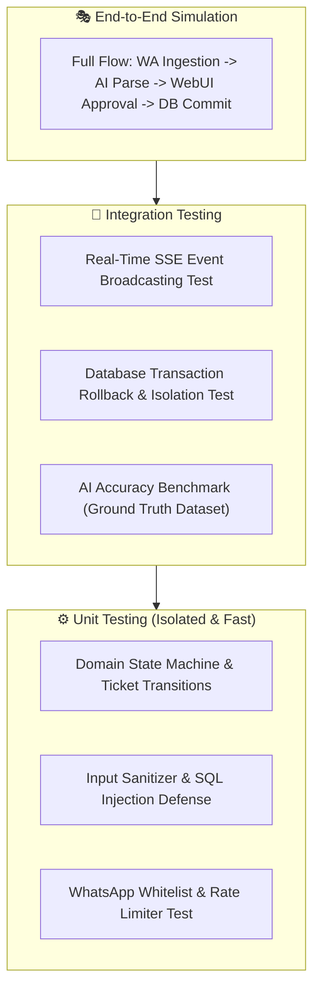

# 🧪 Testing Scheme & Quality Assurance — NovaPilot AI

---

## 1. Testing Philosophy & Strategy

Operating directly on transactional enterprise databases (**Oracle 11g / PostgreSQL 18**) and production communication channels (**WhatsApp**) demands a rigorous testing pyramid:

1. **Zero Unintended Mutation:** No database query executes without strict schema validation and human approval sign-off.
2. **AI Extraction Determinism:** Entity extraction from informal Indonesian/English chat achieves $\ge 95\%$ accuracy.
3. **High Portability for CI/CD:** All unit and mock tests run headlessly in GitHub Actions without requiring physical database servers or active WhatsApp numbers.

---

## 2. Testing Layers



---

## 3. Detailed Test Specifications

### 3.1 Unit Testing (Golang Core)
- **Target:** Testing business logic free of external network or database dependencies.
- **Frameworks:** Native Go `testing`, `testify/assert`, `testify/require`.
- **Key Test Cases:**
  - **State Machine Transitions:**
    - `PENDING_APPROVAL` $\rightarrow$ `APPROVED` $\rightarrow$ `EXECUTED` (Valid).
    - `PENDING_APPROVAL` $\rightarrow$ `EXECUTED` (Forbidden: cannot bypass approval).
    - `REJECTED` $\rightarrow$ `APPROVED` (Forbidden: rejected tickets cannot be executed).
  - **Input Sanitization:** Stripping malicious escape characters and SQL injection attempts.
  - **Whitelist Filtering:** Immediate drop of incoming messages from unverified groups.

### 3.2 Database Mock & Transaction Testing
- **Target:** Validating query parameterization and rollback behavior.
- **Frameworks:** `DATA-DOG/go-sqlmock` and in-memory SQLite adapter.
- **Key Test Cases:**
  - Pre-check queries must use positional bind variables (`$1` or `:1`).
  - Mutations must occur within an explicit `tx.Begin()` and `tx.Commit()`.
  - Transaction rollback verification upon simulated timeout or table lock errors.

### 3.3 AI Evaluation Benchmark (AI Evals)
- **Dataset (`tests/datasets/chat_eval_dataset.jsonl`):**
  - 50 real-world branch chat scenarios (slang, typographical errors, diverse invoice formats).
  - Paired ground truth targets.
- **Acceptance Thresholds:**
  - **Intent Accuracy:** $\ge 98\%$
  - **Entity Precision (Invoice Number & Customer Name):** $\ge 95\%$
  - **Hallucination Rate:** $\le 1\%$ (Model must never fabricate invoice numbers).

### 3.4 WebUI Component & Flow Testing
- **Frameworks:** Vitest + Svelte Testing Library, Playwright.
- **Key Test Cases:**
  - Real-time rendering of new ticket cards upon receiving Server-Sent Events.
  - High-contrast visual diff display (strikethrough red for previous value, green for proposed value).
  - Action button triggers: Approve modal dispatch, loading states, and audit table migration.
  - Mobile viewport compatibility (375px–430px) for smartphone on-call duty.

---

## 4. Test Execution Cheat Sheet

```bash
# 1. Run all Golang unit tests with race detection & coverage
cd backend
go test -v -race -cover ./...

# 2. Run SvelteKit type checks and component tests
cd ../frontend
bun run check
bun run test
```
