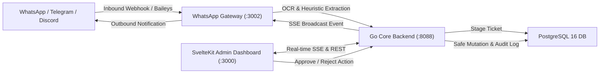
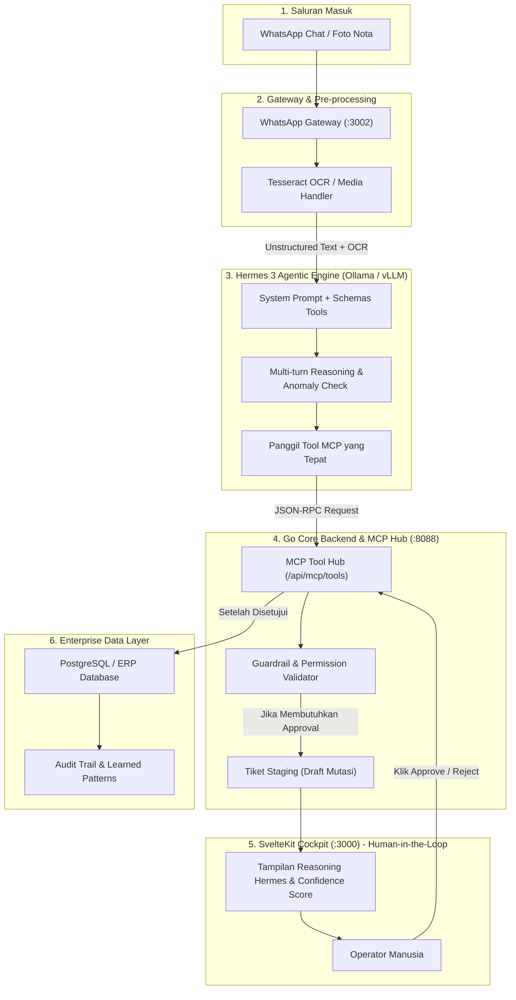
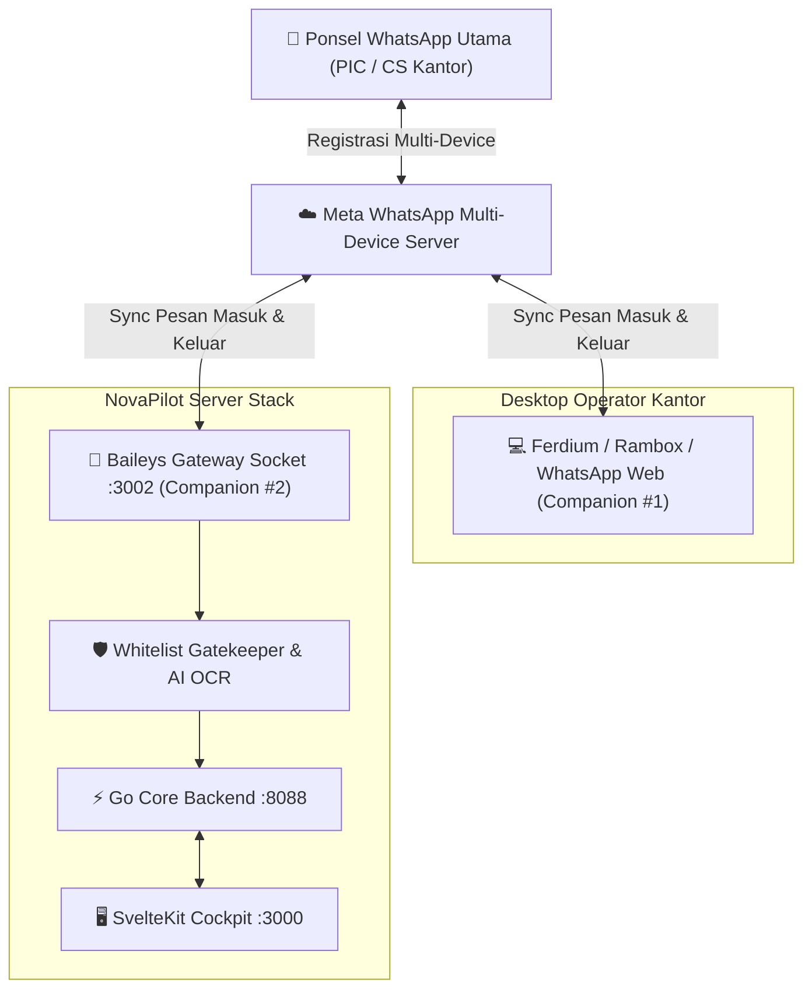
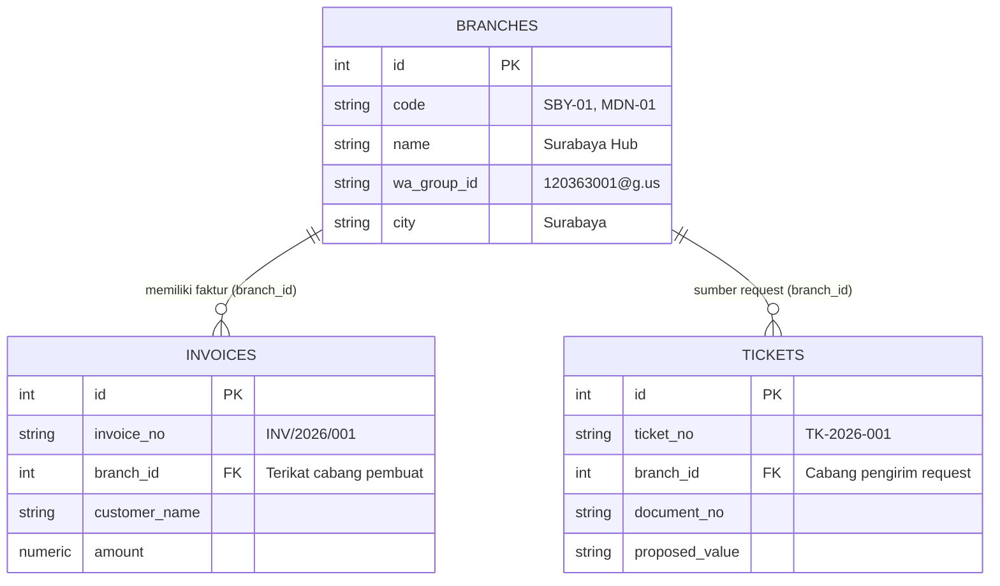

# NovaPilot AI — Master Plan & Staging Buffer Roadmap

> ⚠️ **DISCLAIMER WORKFLOW KANTOR & PERANTARA TAMPUNGAN SEMENTARA**  
> Dokumen ini difungsikan secara khusus sebagai **perantara & tampungan sementara (staging buffer)** dari laptop kantor.  
> **Fokus Laptop Kantor Saat Ini**: Khusus mengerjakan **revisi desain, UI/UX polish, SVG micro-animations, layout styling, dan pengujian visual interface**.  
> **Ide Teknis Rombakan Besar**: Seluruh blueprint arsitektural berat, refactoring backend mendalam, integrasi model AI/LLM, dan migrasi infrastruktur database ditampung dan distrukturkan di sini terlebih dahulu agar tidak mengganggu stabilitas kerja harian kantor, untuk kemudian dieksekusi terfokus di workstation utama (rumah / sesi deep-focus).

---

## 1. Arsitektur & Gambaran Sistem Saat Ini

NovaPilot AI adalah platform ChatOps omnichannel yang menjembatani platform komunikasi (WhatsApp, Telegram, Discord, Slack) dengan database inti enterprise secara aman menggunakan pendekatan **Human-in-the-Loop (HITL)** dan **Guardrail Database Protection**.



---

## 2. Blueprint Integrasi Hermes (Nous Hermes 3 Agentic LLM)

### 2.1 Apa Itu Hermes & Mengapa Relevan untuk NovaPilot AI?
**Hermes** (khususnya seri **Hermes 3** dari Nous Research berbasis Llama 3.1 8B/70B) adalah salah satu model *open-weights* terbaik di dunia untuk:
1. **Advanced Function & Tool Calling**: Fine-tuned secara khusus untuk mengenali skema JSON alat, memanggil multiple tools secara berantai (*agentic loop*), dan menghasilkan output JSON yang valid 100%.
2. **Chain-of-Thought & Multi-turn Reasoning**: Mampu menjelaskan alur penalarannya sebelum mengambil tindakan atau merekomendasikan mutasi data.
3. **Privasi & Keamanan Data (On-Premises / Air-Gapped)**: Dapat dijalankan secara lokal menggunakan **Ollama**, **vLLM**, atau **llama.cpp** tanpa mengirimkan data faktur / transaksi keuangan perusahaan yang bersifat rahasia ke cloud pihak ketiga (OpenAI/Anthropic).

### 2.2 Diagram Alur Integrasi Hermes ke NovaPilot AI



---

### 2.3 Fitur-Fitur Kunci yang Bisa Diintegrasikan dengan Hermes

| Fitur | Deskripsi Teknis | Keuntungan Bisnis / UX |
| :--- | :--- | :--- |
| **1. Autonomous MCP Tool Selection** | Hermes membaca katalog tools dari `/api/mcp/tools` (misal `mutate_invoice_record`, `query_customer_master`, `verify_tax_registration`) dan secara otomatis memilih fungsi serta mengisi parameter JSON-nya dari chat pelanggan yang berantakan. | Mengeliminasi kebutuhan regex kaku yang sering gagal jika pelanggan memakai bahasa gaul atau singkatan. |
| **2. Transparansi Penalaran (Reasoning Trace)** | Hermes menghasilkan tag `<thought>` yang menjelaskan mengapa data ini diubah dan dasar perhitungannya. | Memberikan konteks lengkap kepada operator di Dashboard SvelteKit sebelum menekan tombol Approve. |
| **3. Deteksi Anomali & Fraud Guardrail** | Hermes membandingkan data request baru dengan data master atau histori audit (misalnya perubahan nomor rekening mencurigakan, nominal melonjak drastis). | Mencegah pembobolan atau kesalahan mutasi keuangan fatal sejak gerbang pertama. |
| **4. Auto-Clarification (Outbound WhatsApp)** | Jika foto nota blur atau chat ambigu, Hermes membuat draf pertanyaan klarifikasi yang sopan untuk dikirim balik via WhatsApp Gateway. | Menghemat waktu admin kantor dari mengetik manual balasan klarifikasi berkali-kali. |
| **5. Sintesis Pola Pembelajaran (Learned Patterns)** | Saat reviewer menolak tiket disertai catatan human feedback ("Jangan potong PPN untuk CV tertentu"), Hermes mensintesis feedback ini menjadi aturan regex/prompt baru di tabel `learned_patterns`. | Sistem semakin pintar seiring berjalannya waktu tanpa perlu coding ulang backend. |

---

## 3. Tampungan Ide Teknis Rombakan Besar (Backlog Workstation Utama)

Berikut adalah daftar ide teknis mendalam yang dicatat di laptop kantor dan distaging untuk dikerjakan di workstation utama:

### 🛠️ Rombakan 1: Hermes LLM Engine Adapter di Go Backend
- **Tujuan**: Membuat package `internal/llm/hermes_adapter.go` di Go Core Backend.
- **Spesifikasi**:
  - Mendukung endpoint OpenAI-compatible (`http://localhost:11434/v1` untuk Ollama atau port `8000` untuk vLLM).
  - Parser khusus untuk output Hermes 3: menangani blok `<thought>...</thought>` dan `<tool_call>...</tool_call>`.
  - Fallback otomatis ke heuristic rule jika engine LLM offline.

### 🛠️ Rombakan 2: Queue & Baileys Multi-Device Cluster
- **Tujuan**: Memisahkan session WhatsApp Gateway menjadi microservice cluster dengan Redis / RabbitMQ.
- **Spesifikasi**:
  - Mendukung banyak nomor WhatsApp CS secara simultan.
  - Rate limiting pintar agar nomor tidak terblokir oleh Meta (jeda acak 2-5 detik antar pesan outbound).

### 🛠️ Rombakan 3: Database Isolation & Sandboxed MCP Tool Execution
- **Tujuan**: Menjalankan eksekusi script tools MCP di dalam isolated worker container (WASM atau micro-VM).
- **Spesifikasi**:
  - Perlindungan zero-trust: script pihak ketiga tidak memiliki akses raw ke network atau filesystem backend.
  - Read-only replica untuk database referensi dan transaksi atomic dua fase (2PC) untuk commit mutasi.

### 🛠️ Rombakan 4: Full Automated E2E Regression Suite (Playwright)
- **Tujuan**: Menghubungkan browser headless Playwright dengan live session Baileys dan dashboard.
- **Spesifikasi**:
  - Mengetes alur pengiriman gambar di WhatsApp -> muncul di tiket dashboard -> klik Approve -> database ter-update -> notifikasi terkirim balik ke pengirim.

---

## 4. Alur Kerja Kantor (Laptop Kantor) Saat Ini: UI & Design Revision Focus

Di lingkungan laptop kantor, aktivitas dibatasi secara ketat pada ranah visual dan performa tampilan:

1. **Revisi UI & Komponen SvelteKit**:
   - Memperhalus typography (Geist Sans & Geist Mono), spacing, padding, dan kontras warna.
   - Pengecilan scrollbar global menjadi ultra-sleek (5px, 1/2 lebih ramping dari native browser).
   - Pengorganisasian tata letak kartu, header, tabel data TanStack, dan modal dialog.
2. **Visualisasi SVG & Animasi**:
   - Perbaikan kanvas interaktif SVG (Pan & Zoom dengan mouse drag/wheel).
   - Diferensiasi visual 3 status: *Connected* (mengalir hijau/cyan), *Disconnected* (kabel putus abu-abu, nol paket), dan *Processing* (aliran burst cepat amber/violet).
3. **Kerapian Kode & Verifikasi Lokal**:
   - Menjaga hasil build frontend selalu bersih (`bun run build` tanpa error).
   - Menjalankan unit tests frontend (`bun test`) dan backend (`go test`).
4. **Standar Desain Anti-Collision Toolbar (Pencegahan Nabrak 1-Row di Layar Laptop)**:
   - **Problem Root-Cause**: Memaksa judul panjang, subtitle, dan tombol aksi simulasi berada di 1 baris (`lg:flex-row justify-between`) menyebabkan elemen saling bertabrakan dan wrap berantakan pada layar laptop kantor (lebar viewport 900–1100px).
   - **Solusi Arsitektur UI Multi-Tier**:
     - **Tier 1 (Header Info)**: Khusus judul arsitektur, badge status live (`LIVE ARCHITECTURE`, `PAN & ZOOMABLE`), dan hint gestur kanvas di sisi kanan.
     - **Tier 2 (Dedicated Action Strip)**: Baris terpisah berlatar `bg-secondary/35 border` khusus menampung tombol-tombol simulasi I/O (`DB 1: Core`, `DB 2: MCP Ref`, `Toggle Link`) dan tombol *Reset View*.
     - **Tier 3 (Status Legend Bar)**: Legenda warna status (*Connected*, *Processing*, *Disconnected*) diletakkan di bawah bar aksi tanpa berebut ruang dengan tombol.
   - **Pencegahan Layout Shift**: Label tombol distandarkan agar tidak memanjang/memendek secara drastis saat status berganti sehingga layout tetap stabil dan kokoh.
5. **Standar Sidebar Collapsed (Ikon Lurus Middle & Floating Notification Indicator)**:
   - **Presisi Sumbu Vertikal**: Saat sidebar di-collapse (`w-16`), setiap item menu dibungkus dalam kontainer bujur sangkar `h-9 w-9 mx-auto rounded-xl flex items-center justify-center`. Seluruh ikon berada tepat di sumbu tengah yang sama (lurus vertikal 100%).
   - **Floating Notification Badge**: Indikator angka antrean (`cockpit.pendingCount`, `cockpit.needsReviewCount`) diposisikan sebagai floating badge di sudut kanan atas tombol (`absolute -top-1 -right-1 min-w-[17px] h-4`) sehingga tidak pernah menggeser atau mendistorsi bentuk ikon.
6. **Arsitektur Navigasi Mobile-First (Slide-Over Sheet & Auto-Compact Navbar)**:
   - **Off-Canvas Slide-Over Drawer**: Mengganti dropdown header dengan drawer samping kiri modern ber-backdrop blur (`bg-black/60 z-50`) yang dapat ditutup via klik di luar atau tombol `Escape`.
   - **Ultra-Compact Header (<640px)**: Selector platform secara otomatis menyembunyikan label teks dan hanya menampilkan logo platform pada layar ponsel kecil (360px), menjaga ruang untuk tombol pencarian `⌘K` dan avatar user.
7. **Modal Roster Anggota Grup WhatsApp (Role Inspection & Whitelist Filtering)**:
   - Akses instan ke daftar anggota grup dengan mengklik nama grup, ikon, atau badge `X Anggota →`.
   - Menampilkan metrik ringkas: Total anggota, Admin, On-Call PIC, dan Whitelisted members.
   - Filter pencarian cepat untuk nama, nomor telepon, dan peran (*role*).
   - Fitur toggle Whitelist granular per peserta: memastikan hanya anggota berwenang yang dapat memicu pembuatan tiket mutasi otomatis.
8. **Penyederhanaan Form Pendaftaran Saluran (JID Guidance & Auto-Converter)**:
   - **Bantuan Sumber JID**: Tombol toggle petunjuk `[? Dari mana dapat ID ini?]` untuk memandu operator awam tentang asal-usul ID grup WhatsApp, format nomor kontak, Telegram Chat ID, dan Discord Channel ID.
   - **Konverter 1-Klik No. HP ke JID**: Mengonversi otomatis nomor PIC seperti `+62 812-3456-7890` menjadi format JID WhatsApp yang valid (`6281234567890@s.whatsapp.net`).
   - **Pill Selector Cabang & Kartu Edukasi**: Memudahkan pemilihan cabang resmi perusahaan (`Surabaya Hub`, `Medan Hub`, `Head Office`, dll.) dan memberikan konteks mengapa pemetaan ke `branch_id` database sangat krusial bagi keamanan data.

---

## 5. Arsitektur WhatsApp Multi-Device & Kompatibilitas Multi-Client (Baileys vs Ferdium vs Rambox vs WhatsApp Web)

### 5.1 Bagaimana Baileys Bekerja Bersama Ferdium / Rambox / WhatsApp Web?
Banyak operator bertanya apakah menjalankan **WhatsApp Gateway (Baileys)** di NovaPilot akan membuat WhatsApp Web, Ferdium, atau Rambox di laptop mereka ter-kick / log out. **Jawabannya: 100% Kompatibel dan Aman.**

Di bawah protokol **WhatsApp Multi-Device (MD)** yang dirilis Meta:
- **1 Akun WhatsApp Utama (Ponsel)** dapat menghubungkan hingga **4 Perangkat Pendamping (Companion Devices)** secara bersamaan secara independen tanpa perlu ponsel selalu online.
- **Ferdium / Rambox / Browser (Chrome/Brave)**: Berfungsi sebagai *Companion Device #1* (menjalankan instance webview `web.whatsapp.com`).
- **NovaPilot WhatsApp Gateway (Baileys)**: Berfungsi sebagai *Companion Device #2* (menjalankan socket WebSocket native berprotokol Noise & Signal Protocol terenkripsi).



### 5.2 Alur Kompatibilitas Logika (Zero-Conflict Flow)
1. **Pencegahan Infinite Loop / Echo Bot (`fromMe === true`)**:
   - Ketika operator mengetik pesan secara manual di Ferdium, Rambox, atau WhatsApp Web, Meta otomatis membroadcast pesan tersebut ke seluruh companion device.
   - Baileys menerima pesan tersebut dengan tanda:
     ```ts
     if (!msg.message || msg.key.fromMe) continue;
     ```
   - Baileys langsung mengabaikan pesan yang dikirim oleh operator sendiri (`fromMe === true`), sehingga bot **tidak akan pernah looping** merespons chat dirinya sendiri atau operator kantor.

2. **Resolusi Anggota Grup Granular (`msg.key.participant`)**:
   - Di dalam grup WhatsApp (`@g.us`), `remoteJid` bernilai ID grup (misal `120363xxx@g.us`).
   - Baileys membaca `msg.key.participant` untuk mengetahui secara spesifik **siapa orang (nomor HP)** di dalam grup yang mengirim chat.
   - Di NovaPilot Contacts, admin dapat melihat roster anggota dan mengatur toggle **Whitelist** per anggota. Jika nomor HP pengirim tidak di-whitelist, chat santai anggota grup tidak akan mengotori pipeline staging tiket.

3. **Sinkronisasi Notifikasi Outbound Real-Time**:
   - Ketika reviewer di Cockpit SvelteKit menyetujui mutasi data, Go Backend memicu SSE ke Baileys untuk mengirim pesan balasan (`sock.sendMessage`).
   - Begitu Baileys mengirim pesan, pesan konfirmasi tersebut **langsung seketika muncul di jendela chat Ferdium / Rambox / WhatsApp Web** milik operator kantor, sehingga operator selalu memiliki visibilitas percakapan 100% konsisten.

---

## 6. Penjelasan Mekanisme "Monitoring Probe" & Health Telemetry

Di menu `/dashboard/contacts`, kolom **Monitoring Probe** menunjukkan kondisi live soket dan latensi jaringan komunikasi antara NovaPilot dengan kanal target:

| Status Probe | Arti Teknis | Respon Sistem NovaPilot |
| :--- | :--- | :--- |
| `ACTIVE` (Hijau Berkedip) | Soket terhubung, event listener aktif, dan koneksi ke grup/hotline responsif. | Pesan masuk dan media gambar langsung diproses oleh AI pipeline. |
| `STANDBY` (Kuning) | Kanal terdaftar namun tidak ada traffic pesan baru dalam periode waktu tertentu, soket dalam mode hemat daya / idle keep-alive. | Siap menerima pesan kapan pun tanpa delay inisialisasi. |
| `MUTED` (Abu-Abu) | Kanal sengaja diabaikan atau toggle *Whitelist Intake* dimatikan oleh admin. | Pesan yang masuk langsung di-drop di layer gatekeeper (hemat token AI & nol noise). |
| `Latency (ms)` | Mengukur Round-Trip Time (RTT) probe socket dari Baileys gateway menuju server perantara / webhook internal. | Nilai normal berkisar antara 60ms – 160ms. |

### Tombol "Simulasi"
Tombol **Simulasi** pada setiap baris kontak berfungsi untuk mengirim paket probe sintetis ke endpoint `/api/inbound-messages`. Fitur ini digunakan operator kantor untuk memverifikasi secara instan apakah pipeline ingest webhook, filter regex, dan penghubung database berjalan normal tanpa harus menunggu chat riil dari lapangan.

---

## 7. Arsitektur Multi-Tenancy Cabang & Resolusi JID Saluran (Database & Ingress Routing)

### 7.1 Dari Mana JID / Identifier Saluran Didapatkan?
**JID (*Jabber ID*)** adalah alamat pengenal unik standar protokol WhatsApp (berbasis turunan XMPP). Format bakunya adalah:
- **Kontak Hotline PIC Perorangan**: `<nomor_hp_internasional>@s.whatsapp.net` (misal `6281234567890@s.whatsapp.net`).
- **Grup WhatsApp**: `<id_unik_timestamp>@g.us` (misal `120363028192837492@g.us`).

#### 3 Cara Praktis Mendapatkan JID di Lingkungan Nyata:
1. **Cara 1: Membaca Terminal Log Baileys (Paling Mudah & Standar di NovaPilot)**
   - Masukkan nomor bot WhatsApp ke dalam grup WA cabang kantor.
   - Siapa pun di grup mengirimkan 1 chat uji coba (misal: *"Halo"*).
   - Baileys Gateway seketika mencetak log di terminal dan menu `/admin/whatsapp`:
     ```
     [INCOMING CHAT from 120363028192837492@g.us (Ops Cabang Surabaya)]: Halo ...
     ```
   - Operator cukup menyalin ID berakhiran `@g.us` tersebut ke form pendaftaran saluran.
2. **Cara 2: Lewat WhatsApp Web / Ferdium / Rambox**
   - Buka grup di browser atau Ferdium/Rambox.
   - Klik kanan pada nama grup -> *Inspect Element* (F12) -> ID grup tertera pada atribut data elemen percakapan.
3. **Cara 3: Konverter Otomatis No. HP PIC di Form**
   - Untuk kontak perorangan, operator cukup mengetikkan nomor HP lokal (misal `+62 812-3456-7890`).
   - Form menyediakan tombol **"Konversi otomatis No. HP PIC ke JID"** yang otomatis memformatnya menjadi `6281234567890@s.whatsapp.net`.
4. **Platform Lain**:
   - **Telegram**: Chat ID numerik (misal `-100192837482`), didapat dari bot `@userinfobot`.
   - **Discord**: Channel ID 18 digit, didapat dari klik kanan channel -> *Copy Channel ID* (aktifkan *Developer Mode*).
   - **Slack**: Channel ID (misal `C0819283ABC`), didapat dari klik kanan channel -> *View channel details*.

---

### 7.2 Pengaruh Cabang / Regional Hub terhadap Struktur Database & Logika Aplikasi

Bidang **Cabang / Regional Hub** adalah fondasi partisi data (**Multi-Tenancy**) dan sistem proteksi AI (**Guardrail**).

#### A. Relasi di Struktur Database PostgreSQL (`01_schema.sql`)
Di skema database inti (`backend/scripts/mock_db/01_schema.sql`):



1. **Partisi Kepemilikan Faktur**: Setiap faktur di tabel `invoices` (misal `INV/2026/001`) memiliki Foreign Key `branch_id INT REFERENCES branches(id)`. Ini berarti faktur tersebut secara legal dan akuntansi adalah aset milik **Cabang Surabaya Hub (ID: 1)**.
2. **Pemetaan Otomatis Pesan Masuk**: Saat pesan masuk dari grup WhatsApp Surabaya (`120363001@g.us`), Go backend otomatis mencocokkan `wa_group_id` dengan tabel `branches` untuk menetapkan `ticket.branch_id = 1`.

#### B. Pengaruh Terhadap Logika Aplikasi & AI Guardrail
1. **Pencegahan Anomali Lintas Cabang (*Cross-Branch Mismatch Protection*)**:
   - Jika grup WhatsApp **Cabang Medan** (`branch_id: 2`) mengirim pesan: *"Tolong ubah customer faktur INV/2026/001 menjadi CV Bintang Timur"*.
   - AI Guardrail memeriksa database: faktur `INV/2026/001` adalah milik **Cabang Surabaya** (`branch_id: 1`).
   - Sistem seketika mendeteksi **Branch Mismatch** dan memblokir eksekusi otomatis. Tiket ditandai `NEEDS_REVIEW` dengan peringatan merah:
     > ⚠️ *"Peringatan Anomali: Permintaan mutasi berasal dari Cabang Medan, tetapi faktur terdaftar di Cabang Surabaya."*
   - Fitur ini mencegah fraud tagihan, kesalahan kamar penagihan, atau modifikasi data antar gudang tanpa izin.
2. **Routing Notifikasi Outbound Tepat Sasaran**:
   - Ketika operator di Cockpit menyetujui mutasi dokumen, backend mencari `branches.wa_group_id` dari cabang bersangkutan.
   - Notifikasi sukses **hanya dikirimkan balik ke grup cabang pengaju**, sehingga obrolan operasional tidak bocor ke grup cabang lain.
3. **Multi-Tenancy & Pembatasan Otoritas Approval**:
   - Kepala Gudang / Supervisor Surabaya hanya diizinkan meng-approve tiket yang memiliki `branch_id` Surabaya, menjaga tata kelola SOP enterprise (HITL).
4. **Pill Selector Cabang di Form**:
   - Disediakan tombol cepat untuk cabang yang sudah terdaftar di database (`Surabaya Hub`, `Medan Hub`, `Head Office`, `Semarang Hub`, `Cikarang Plant`, `Makassar Hub`).

---

## 8. Strategi Sinkronisasi Kerja: Kantor vs. Rumah

### Solusi Standar: Git Remote / Git Bundle
1. **Opsi Rekomendasi (GitHub Private Repo)**:
   - **Di Kantor** (sebelum pulang):
     ```bash
     git add .
     git commit -m "style(ui): deskripsi revisi desain dari laptop kantor"
     git push origin main
     ```
   - **Di Rumah** (sebelum mulai sesi coding berat):
     ```bash
     git pull origin main
     ```
2. **Opsi Offline / Terisolasi (Git Bundle)**:
   Jika laptop kantor memblokir koneksi ke GitHub pribadi:
   - Buat satu file bundle diff (tanpa `node_modules` atau binary):
     ```bash
     git bundle create novapilot-design.bundle HEAD main
     ```
   - Di rumah, tarik bundle tersebut:
     ```bash
     git pull /path/to/novapilot-design.bundle main
     ```

---

## 9. Status Pengujian & Quality Assurance

Sistem pengujian saat ini telah terstruktur rapi:

```
tests/
├── unit/
│   ├── backend/
│   │   ├── ticket_service_test.go      # Logika approval, staging, reject, dan policy check
│   │   ├── repository_test.go          # Proteksi mutasi database & in-memory repo
│   │   └── api_handler_test.go         # Gin handler & regex classifier
│   ├── gateway/
│   │   └── extractor.test.ts           # Ekstraksi regex invoice, nomor dokumen, dan intent
│   └── frontend/
│       └── utils.test.ts               # Formatter string, utilitas class merging, cockpit state
├── integration/
│   ├── backend_api_test.go             # Lifecycle lengkap REST API Go Backend & SSE Hub
│   └── gateway_backend_test.ts         # Integrasi HTTP Gateway ke Backend /api/inbound-messages
└── e2e/
    └── e2e_flow.test.ts                # Simulasi end-to-end pesan masuk -> staging -> approve -> DB mutate
```

### Perintah Cepat Menjalankan Pengujian
- **Frontend Unit Test**: `cd frontend && bun test` (9/9 pass)
- **Backend Unit & Integration Test**: `cd backend && go test ./...` (100% pass)
- **Build Verification**: `cd frontend && bun run build` (684 modul terkompilasi bersih)
