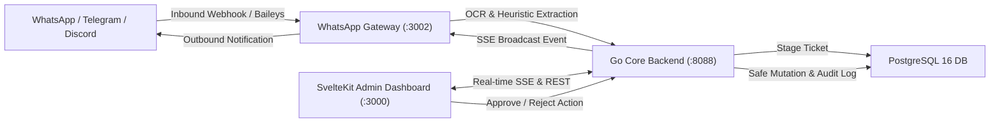
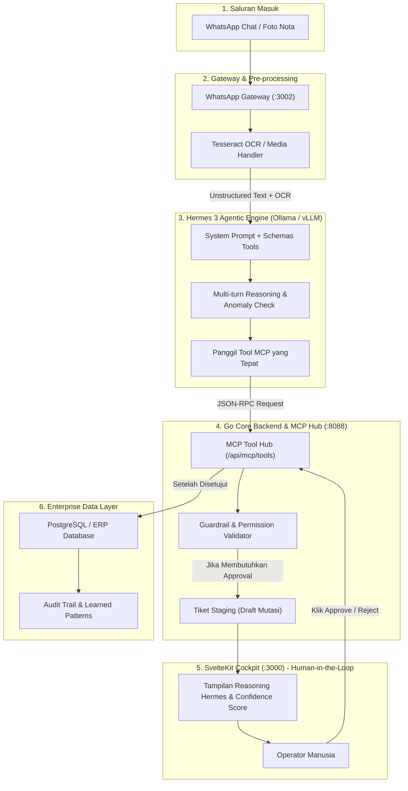

# NovaPilot AI — Master Plan & Staging Buffer Roadmap

> ⚠️ **DISCLAIMER WORKFLOW KANTOR & PERANTARA TAMPUNGAN SEMENTARA**  
> Dokumen ini difungsikan secara khusus sebagai **perantara & tampungan sementara (staging buffer)** dari laptop kantor.  
> **Fokus Laptop Kantor Saat Ini**: Khusus mengerjakan **revisi desain, UI/UX polish, SVG micro-animations, layout styling, dan pengujian visual interface**.  
> **Ide Teknis Rombakan Besar**: Seluruh blueprint arsitektural berat, refactoring backend mendalam, integrasi model AI/LLM, dan migrasi infrastruktur database ditampung dan distrukturkan di sini terlebih dahulu agar tidak mengganggu stabilitas kerja harian kantor, untuk kemudian dieksekusi terfokus di workstation utama (rumah / sesi deep-focus).

---

## 1. Arsitektur & Gambaran Sistem Saat Ini

NovaPilot AI adalah platform ChatOps omnichannel yang menjembatani platform komunikasi (WhatsApp, Telegram, Discord, Slack) dengan database inti enterprise secara aman menggunakan pendekatan **Human-in-the-Loop (HITL)** dan **Guardrail Database Protection**.



---

## 2. Blueprint Integrasi Hermes (Nous Hermes 3 Agentic LLM)

### 2.1 Apa Itu Hermes & Mengapa Relevan untuk NovaPilot AI?
**Hermes** (khususnya seri **Hermes 3** dari Nous Research berbasis Llama 3.1 8B/70B) adalah salah satu model *open-weights* terbaik di dunia untuk:
1. **Advanced Function & Tool Calling**: Fine-tuned secara khusus untuk mengenali skema JSON alat, memanggil multiple tools secara berantai (*agentic loop*), dan menghasilkan output JSON yang valid 100%.
2. **Chain-of-Thought & Multi-turn Reasoning**: Mampu menjelaskan alur penalarannya sebelum mengambil tindakan atau merekomendasikan mutasi data.
3. **Privasi & Keamanan Data (On-Premises / Air-Gapped)**: Dapat dijalankan secara lokal menggunakan **Ollama**, **vLLM**, atau **llama.cpp** tanpa mengirimkan data faktur / transaksi keuangan perusahaan yang bersifat rahasia ke cloud pihak ketiga (OpenAI/Anthropic).

### 2.2 Diagram Alur Integrasi Hermes ke NovaPilot AI



---

### 2.3 Fitur-Fitur Kunci yang Bisa Diintegrasikan dengan Hermes

| Fitur | Deskripsi Teknis | Keuntungan Bisnis / UX |
| :--- | :--- | :--- |
| **1. Autonomous MCP Tool Selection** | Hermes membaca katalog tools dari `/api/mcp/tools` (misal `mutate_invoice_record`, `query_customer_master`, `verify_tax_registration`) dan secara otomatis memilih fungsi serta mengisi parameter JSON-nya dari chat pelanggan yang berantakan. | Mengeliminasi kebutuhan regex kaku yang sering gagal jika pelanggan memakai bahasa gaul atau singkatan. |
| **2. Transparansi Penalaran (Reasoning Trace)** | Hermes menghasilkan tag `<thought>` yang menjelaskan mengapa data ini diubah dan dasar perhitungannya. | Memberikan konteks lengkap kepada operator di Dashboard SvelteKit sebelum menekan tombol Approve. |
| **3. Deteksi Anomali & Fraud Guardrail** | Hermes membandingkan data request baru dengan data master atau histori audit (misalnya perubahan nomor rekening mencurigakan, nominal melonjak drastis). | Mencegah pembobolan atau kesalahan mutasi keuangan fatal sejak gerbang pertama. |
| **4. Auto-Clarification (Outbound WhatsApp)** | Jika foto nota blur atau chat ambigu, Hermes membuat draf pertanyaan klarifikasi yang sopan untuk dikirim balik via WhatsApp Gateway. | Menghemat waktu admin kantor dari mengetik manual balasan klarifikasi berkali-kali. |
| **5. Sintesis Pola Pembelajaran (Learned Patterns)** | Saat reviewer menolak tiket disertai catatan human feedback ("Jangan potong PPN untuk CV tertentu"), Hermes mensintesis feedback ini menjadi aturan regex/prompt baru di tabel `learned_patterns`. | Sistem semakin pintar seiring berjalannya waktu tanpa perlu coding ulang backend. |

---

## 3. Tampungan Ide Teknis Rombakan Besar (Backlog Workstation Utama)

Berikut adalah daftar ide teknis mendalam yang dicatat di laptop kantor dan distaging untuk dikerjakan di workstation utama:

### 🛠️ Rombakan 1: Hermes LLM Engine Adapter di Go Backend
- **Tujuan**: Membuat package `internal/llm/hermes_adapter.go` di Go Core Backend.
- **Spesifikasi**:
  - Mendukung endpoint OpenAI-compatible (`http://localhost:11434/v1` untuk Ollama atau port `8000` untuk vLLM).
  - Parser khusus untuk output Hermes 3: menangani blok `<thought>...</thought>` dan `<tool_call>...</tool_call>`.
  - Fallback otomatis ke heuristic rule jika engine LLM offline.

### 🛠️ Rombakan 2: Queue & Baileys Multi-Device Cluster
- **Tujuan**: Memisahkan session WhatsApp Gateway menjadi microservice cluster dengan Redis / RabbitMQ.
- **Spesifikasi**:
  - Mendukung banyak nomor WhatsApp CS secara simultan.
  - Rate limiting pintar agar nomor tidak terblokir oleh Meta (jeda acak 2-5 detik antar pesan outbound).

### 🛠️ Rombakan 3: Database Isolation & Sandboxed MCP Tool Execution
- **Tujuan**: Menjalankan eksekusi script tools MCP di dalam isolated worker container (WASM atau micro-VM).
- **Spesifikasi**:
  - Perlindungan zero-trust: script pihak ketiga tidak memiliki akses raw ke network atau filesystem backend.
  - Read-only replica untuk database referensi dan transaksi atomic dua fase (2PC) untuk commit mutasi.

### 🛠️ Rombakan 4: Full Automated E2E Regression Suite (Playwright)
- **Tujuan**: Menghubungkan browser headless Playwright dengan live session Baileys dan dashboard.
- **Spesifikasi**:
  - Mengetes alur pengiriman gambar di WhatsApp -> muncul di tiket dashboard -> klik Approve -> database ter-update -> notifikasi terkirim balik ke pengirim.

---

## 4. Alur Kerja Kantor (Laptop Kantor) Saat Ini: UI & Design Revision Focus

Di lingkungan laptop kantor, aktivitas dibatasi secara ketat pada ranah visual dan performa tampilan:

1. **Revisi UI & Komponen SvelteKit**:
   - Memperhalus typography (Geist Sans & Geist Mono), spacing, padding, dan kontras warna.
   - Pengecilan scrollbar global menjadi ultra-sleek (5px, 1/2 lebih ramping dari native browser).
   - Pengorganisasian tata letak kartu, header, tabel data TanStack, dan modal dialog.
2. **Visualisasi SVG & Animasi**:
   - Perbaikan kanvas interaktif SVG (Pan & Zoom dengan mouse drag/wheel).
   - Diferensiasi visual 3 status: *Connected* (mengalir hijau/cyan), *Disconnected* (kabel putus abu-abu, nol paket), dan *Processing* (aliran burst cepat amber/violet).
3. **Kerapian Kode & Verifikasi Lokal**:
   - Menjaga hasil build frontend selalu bersih (`bun run build` tanpa error).
   - Menjalankan unit tests frontend (`bun test`) dan backend (`go test`).

---

## 5. Strategi Sinkronisasi Kerja: Kantor vs. Rumah

### Solusi Standar: Git Remote / Git Bundle
1. **Opsi Rekomendasi (GitHub Private Repo)**:
   - **Di Kantor** (sebelum pulang):
     ```bash
     git add .
     git commit -m "style(ui): deskripsi revisi desain dari laptop kantor"
     git push origin main
     ```
   - **Di Rumah** (sebelum mulai sesi coding berat):
     ```bash
     git pull origin main
     ```
2. **Opsi Offline / Terisolasi (Git Bundle)**:
   Jika laptop kantor memblokir koneksi ke GitHub pribadi:
   - Buat satu file bundle diff (tanpa `node_modules` atau binary):
     ```bash
     git bundle create novapilot-design.bundle HEAD main
     ```
   - Di rumah, tarik bundle tersebut:
     ```bash
     git pull /path/to/novapilot-design.bundle main
     ```

---

## 6. Status Pengujian & Quality Assurance

Sistem pengujian saat ini telah terstruktur rapi:

```
tests/
├── unit/
│   ├── backend/
│   │   ├── ticket_service_test.go      # Logika approval, staging, reject, dan policy check
│   │   ├── repository_test.go          # Proteksi mutasi database & in-memory repo
│   │   └── api_handler_test.go         # Gin handler & regex classifier
│   ├── gateway/
│   │   └── extractor.test.ts           # Ekstraksi regex invoice, nomor dokumen, dan intent
│   └── frontend/
│       └── utils.test.ts               # Formatter string, utilitas class merging, cockpit state
├── integration/
│   ├── backend_api_test.go             # Lifecycle lengkap REST API Go Backend & SSE Hub
│   └── gateway_backend_test.ts         # Integrasi HTTP Gateway ke Backend /api/inbound-messages
└── e2e/
    └── e2e_flow.test.ts                # Simulasi end-to-end pesan masuk -> staging -> approve -> DB mutate
```

### Perintah Cepat Menjalankan Pengujian
- **Frontend Unit Test**: `cd frontend && bun test` (9/9 pass)
- **Backend Unit & Integration Test**: `cd backend && go test ./...` (100% pass)
- **Build Verification**: `cd frontend && bun run build` (684 modul terkompilasi bersih)
