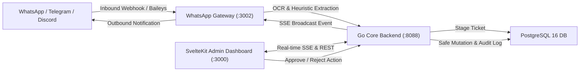

# NovaPilot AI — Master Plan & Strategic Roadmap

> **Status Dokumen**: Active / Approved  
> **Revisi Terakhir**: 14 Oktober 2026  
> **Target Arsitektur**: Autonomous ChatOps & Human-in-the-Loop Database Gatekeeper  

---

## 1. Arsitektur & Gambaran Sistem

NovaPilot AI adalah platform ChatOps omnichannel yang menjembatani platform komunikasi (WhatsApp, Telegram, Discord, Slack) dengan database inti enterprise secara aman menggunakan pendekatan **Human-in-the-Loop (HITL)** dan **Guardrail Database Protection**.



---

## 2. Strategi Sinkronisasi Kerja: Kantor vs. Rumah

### Permasalahan Alur Lama (Zip & Ekstrak)
- Risiko tertimpanya file build lokal (`.svelte-kit`, binary `server.exe`, `.baileys_auth`).
- Ukuran file zip membengkak akibat folder `node_modules` yang ikut ter-copy.
- Kehilangan riwayat commit dan branch tracking Git.

### Solusi Standar: Git Remote / Git Bundle
1. **Opsi Rekomendasi (GitHub Private Repo)**:
   - Di Kantor:
     ```bash
     git add .
     git commit -m "feat/fix: deskripsi perubahan"
     git push origin main
     ```
   - Di Rumah:
     ```bash
     git pull origin main
     ```
2. **Opsi Offline / Terisolasi (Git Bundle)**:
   Jika laptop kantor memblokir koneksi ke GitHub pribadi:
   - Buat satu file bundle diff (tanpa node_modules/binary):
     ```bash
     git bundle create novapilot.bundle HEAD main
     ```
   - Di rumah, tarik bundle tersebut:
     ```bash
     git pull /path/to/novapilot.bundle main
     ```

---

## 3. Matriks Prioritas Kerja di Kantor (Waktu Luang / Side Focus)

| Prioritas | Fitur / Area | Deskripsi & Tindakan | Estimasi |
| :--- | :--- | :--- | :--- |
| **P0 (Kritis)** | **Testing Suite Komprehensif** | Implementasi Unit, Integration, dan E2E test untuk Backend, Frontend, dan Gateway. | Selesai |
| **P1 (Tinggi)** | **WhatsApp Outbound API (`POST /api/send`)** | Menambahkan endpoint pengiriman pesan manual di WhatsApp Gateway dan form quick-reply di Dashboard. | 1-2 Jam |
| **P2 (Sedang)** | **Validasi Guardrail & Multi-DB** | Pengujian konektor PostgreSQL vs MySQL di `/dashboard/connectors` serta proteksi query injection. | 2 Jam |
| **P3 (Rendah)** | **Docker/Podman Verification** | Uji coba stack kontainer `docker-compose.yml` di environment lokal kantor. | 1 Jam |

---

## 4. Evaluasi WhatsApp Gateway: Kapabilitas & Roadmap Outbound

### Status Saat Ini (Faktual)
- **Sudah Aktif**:
  1. **Inbound Receiver**: Menangkap pesan teks & gambar nota dari Baileys socket.
  2. **OCR Parsing**: Mengekstrak teks dari gambar nota menggunakan `tesseract.js`.
  3. **Auto ACK Inbound**: Otomatis mengirim pesan konfirmasi terima ke pengirim (`sock.sendMessage(fromJid, ...)`).
  4. **Approval Notification Outbound**: Menerima event SSE `ticket_approved` dari Go Backend dan mengirim pesan status sukses ke WhatsApp pengirim.

### Gap yang Perlu Dikembangkan (Outbound Manual)
- Menambahkan HTTP endpoint `POST /api/send` pada `whatsapp-gateway/src/index.ts`:
  ```json
  POST /api/send
  Content-Type: application/json
  {
    "to": "6281234567890@s.whatsapp.net",
    "message": "Halo, dokumen INV/2026/001 telah berhasil diperbarui."
  }
  ```
- Menghubungkan tombol "Balas Cepat" pada halaman dashboard [`frontend/src/routes/dashboard/messages/+page.svelte`](file:///C:/Works/Rifky%20Projects/Workspaces/novapilot-ai/frontend/src/routes/dashboard/messages/+page.svelte).

---

## 5. Strategi & Struktur Testing

Untuk menjamin kualitas dan stabilitas sistem sebelum rilis, pengujian dibagi menjadi 3 lapisan:

```
tests/
├── unit/
│   ├── backend/
│   │   ├── ticket_service_test.go      # Logika bisnis approval, staging, reject, dan policy check
│   │   ├── repository_test.go          # Operasi in-memory & proteksi mutasi database
│   │   └── api_handler_test.go         # Unit test Gin handler & regex classifier
│   ├── gateway/
│   │   └── extractor.test.ts           # Ekstraksi regex invoice, nomor dokumen, dan intent
│   └── frontend/
│       └── utils.test.ts               # Formatter string, utilitas class merging, cockpit state
├── integration/
│   ├── backend_api_test.go             # Lifecycle lengkap REST API Go Backend & SSE Hub
│   └── gateway_backend_test.ts         # Integrasi HTTP Gateway ke Backend /api/inbound-messages
└── e2e/
    └── e2e_flow.test.ts                # Simulasi end-to-end pesan masuk -> staging -> approve -> DB mutate
```

### Panduan Menjalankan Test
- **Semua Test**: `bun run test:all`
- **Backend Test**: `cd backend && go test -v ./...`
- **Gateway & Frontend Test**: `bun test`
- **E2E Flow Test**: `bun test tests/e2e/e2e_flow.test.ts`
